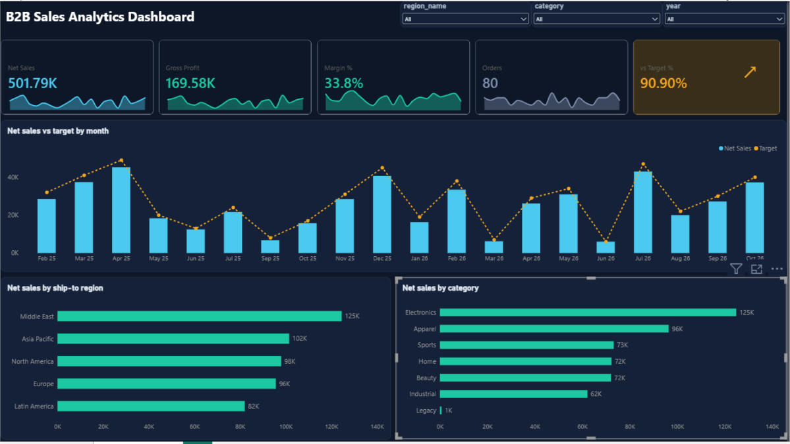
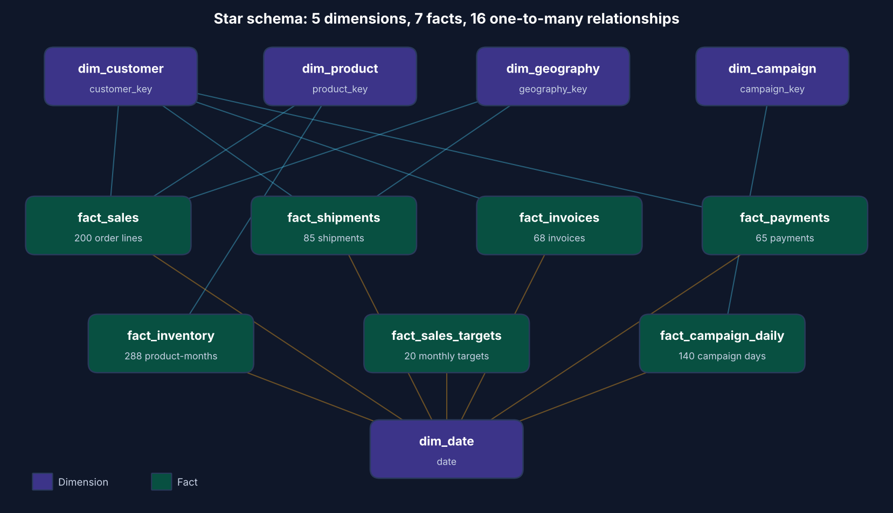
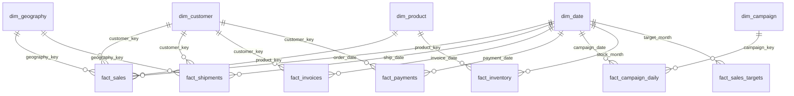

# B2B Sales Analytics Dashboard: Power BI Star Schema Project

An end-to-end Power BI project: messy raw Excel data cleaned in Power Query, modelled as a **star schema**, and presented as an interactive dark-theme sales dashboard.



---

## Business context

**Arka** is a wholesale (B2B) company selling electronics, apparel, home, beauty, sports and industrial products to business customers across 5 regions. The data covers **February 2025 – November 2026** and follows the full *order-to-cash* journey:

**Marketing campaign → Order → Shipment → Invoice → Payment**

### Questions the report answers
- How much do we sell, and are we hitting our monthly targets?
- Which regions, categories and customers drive revenue and profit?
- How fast do we deliver, and which shipping mode is fastest?
- How much has been invoiced but not yet paid?
- Which campaigns drive clicks and spend?

---

## Dataset

One Excel workbook (`raw_tables.xlsx`) with **24 raw sheets**: customers, addresses, contacts, products, subcategories, 2025 and 2026 orders, order lines, shipments, invoices, payments, campaigns, inventory, sales targets, cities/regions and a security mapping.

---

## Data cleaning (Power Query)

| Issue found | Fix |
|---|---|
| Duplicate sheet (`Sheet1` = `shipments`) | Excluded |
| Test records (`TEST ACCOUNT`, `DO NOT USE` product) | Filtered out |
| Duplicate product names with empty attributes | Removed |
| Orders split across `ORDERS_2025` and `ORDERS_2026` | Appended into one table |
| Headers loaded as the first data row | Promoted headers |
| Empty / system-only columns (`GiftMessage`, `hash_key`, `source_id`, `LegacyRef`) | Removed |
| `category|subcategory` stored in one column | Split into two columns |
| Inventory stored wide (one column per month) | **Unpivoted** to one row per product per month |
| Comma-separated SKUs per campaign | Split into rows |
| Campaign details repeated on every daily row | Separated into a dimension + a daily fact |
| 3 retired products in orders but not in the product list | Added as "Legacy" products so no sales are lost |
| `LineTotal` ignored the discount | Calculated gross, discount, net and cost amounts |
| Tables linked by **names** instead of IDs | Replaced with surrogate `_key` columns |

**Approach:** raw tables are kept untouched (load disabled, `raw` group). All cleaning happens in referenced queries in the `dim` and `fact` groups.

---

## Data model: star schema





| Type | Table | Grain (one row = …) |
|---|---|---|
| Dimension | `dim_customer` | one customer (incl. address, region, credit limit, primary contact) |
| Dimension | `dim_product` | one product (incl. category / subcategory) |
| Dimension | `dim_geography` | one city (with region) |
| Dimension | `dim_campaign` | one marketing campaign |
| Dimension | `dim_date` | one calendar day (DAX calendar, marked as date table) |
| Fact | `fact_sales` | one product line on one order (200 rows) |
| Fact | `fact_shipments` | one shipment (85 rows) |
| Fact | `fact_invoices` | one invoice (68 rows) |
| Fact | `fact_payments` | one payment (65 rows) |
| Fact | `fact_campaign_daily` | one campaign on one day (140 rows) |
| Fact | `fact_inventory` | one product in one month (288 rows) |
| Fact | `fact_sales_targets` | one month's revenue target (20 rows) |

**Modelling rules followed:** 16 relationships, all one-to-many with single-direction filters (dimension → fact only, no fact-to-fact joins).

**Naming standards:** English, `snake_case`, `dim_` / `fact_` prefixes, `_key` for surrogate keys and `_id` for source IDs.

---

## Key DAX measures

```DAX
Net Sales      = SUM ( fact_sales[net_amount] )
Gross Profit   = [Net Sales] - SUM ( fact_sales[cost_amount] )
Margin %       = DIVIDE ( [Gross Profit], [Net Sales] )
Orders         = DISTINCTCOUNT ( fact_sales[order_id] )
Target         = SUM ( fact_sales_targets[target_revenue] )
vs Target %    = DIVIDE ( [Net Sales], [Target] )
Outstanding    = SUM ( fact_invoices[invoice_amount] ) - SUM ( fact_payments[payment_amount] )
Avg Days to Deliver = AVERAGE ( fact_shipments[days_to_deliver] )
CTR %          = DIVIDE ( SUM ( fact_campaign_daily[clicks] ), SUM ( fact_campaign_daily[impressions] ) )
```

---

## Key insights

- **Net sales: 501.8K**, with **169.6K gross profit** at a **33.8% margin** across **80 orders**.
- Arka reached **~91% of its revenue target** overall and fell short of target in most months.
- **Middle East** is the top ship-to region (**125K**); **Electronics** is the top category (**125K**).
- **Air** shipping averages **4.6 days** to deliver versus **6.0 (Ground)** and **6.5 (Sea)**.
- About **34.8K** has been invoiced but not yet paid, across 8 open invoices.

---

## Tools

- **Power BI Desktop**: Power Query (M), data modelling, DAX
- **Excel**: source data
- Custom dark report theme (JSON)

---

## How to open

1. Download or clone this repository.
2. Open `B2B_Sales_Analytics_Dashboard.pbix` in Power BI Desktop (free, Windows).
3. If prompted, point the data source to `data/raw_tables.xlsx`: **Transform data → Data source settings → Change source**.

---

## Repository structure

```
├── README.md
├── B2B_Sales_Analytics_Dashboard.pbix
├── data/
│   └── raw_tables.xlsx
└── images/
    ├── page1_sales_overview.png
    └── model_star_schema.png
```

---

*Dataset is fictional and used for learning and portfolio purposes.*
